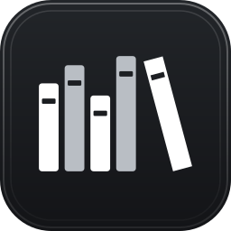

<p align="center"></p>

<h1 align="center">skills</h1>

[](https://skills.sh/yahyabedirhan/skills)

Agent skills the maintainer uses across projects: original skills, and forks of other people's skills with the maintainer's changes. They work with Claude Code, Codex, and any agent the [`skills` CLI](https://github.com/vercel-labs/skills) supports.

They come in five families. Each family's skills are listed under [Skills](#skills) and explained under [How the skills work](#how-the-skills-work):

- **[Effort workflow](#effort-workflow)**: take a feature from an idea to a merged pull request.
- **[Design frameworks](#design-frameworks)**: design or explain code, systems and command-line interfaces step by step.
- **[Communication style](#communication-style)**: how an agent explains and reports its work.
- **[Agent setup](#agent-setup)**: install, maintain and audit what your agents run with.
- **[Daily workflows](#daily-workflows)**: everyday tasks outside the code, such as email and dictation.

## Install

Install any skill by its name from [Skills](#skills):

```bash
npx skills add yahyabedirhan/skills -s <skill-name>
```

For example `-s to-pr`, `-s system-design`, or `-s wispr-flow-dictionary`. Leave out `-s` to pick from a list, and add `-g` to install for your user rather than the current project. Skills in the same family name each other, so install a family together.

### Claude Code plugins

Some skills are also Claude Code plugins, from this repo's marketplace. Add the marketplace once:

```bash
claude plugin marketplace add yahyabedirhan/skills
```

Then install a plugin by name:

| Plugin | Skills | Install |
|---|---|---|
| effort-workflow | The [effort workflow](#effort-workflow) family; installs `show-me` with it | `claude plugin install effort-workflow@yahyabedirhan-skills` |
| show-me | show-me | `claude plugin install show-me@yahyabedirhan-skills` |
| low-level-design | low-level-design | `claude plugin install low-level-design@yahyabedirhan-skills` |
| system-design | system-design | `claude plugin install system-design@yahyabedirhan-skills` |
| cli-design | cli-design | `claude plugin install cli-design@yahyabedirhan-skills` |
| swift-performance | swift-performance | `claude plugin install swift-performance@yahyabedirhan-skills` |
| email | email | `claude plugin install email@yahyabedirhan-skills` |
| wispr-flow-dictionary | wispr-flow-dictionary | `claude plugin install wispr-flow-dictionary@yahyabedirhan-skills` |

A plugin's skills run as `/<plugin>:<skill>` or by their bare name, such as `/to-pr`. The [Agent setup](#agent-setup) skills aren't plugins: `set-up-machine` wires a hook to its installed path, which a plugin update would move.

Install a skill one way or the other, not both. Claude Code loads it twice, and the bare name runs the `npx skills` copy, so plugin updates go unseen. To switch to the plugin, first remove the copy with `npx skills remove <skill-name>`, and add `-g` for a global install.

## Skills

The Origin column names the upstream commit each fork was copied from, so a later upstream change can be diffed against it.
Each fork's full list of changes is in [docs/forks.md](docs/forks.md).

### Effort workflow

| Skill | What it does | Origin |
|---|---|---|
| [init-effort](skills/init-effort/SKILL.md) | Starts an effort on its own branch and worktree, or a new project in its own GitHub repo. It then starts the effort's thinking session in your session host. | Original. |
| [orchestrating](skills/orchestrating/SKILL.md) | The orchestrator's discipline: it delegates the work, stays your one contact and asks you only about a critical blocker. It also holds the effort lifecycle and when to notify you. | Original. |
| [orchestrate-effort](skills/orchestrate-effort/SKILL.md) | Builds an effort from its spec and tickets through sub-agents and opens the pull request. | Original. |
| [handoff](skills/handoff/SKILL.md) | Writes a handoff document in the handoff folder for another session to pick up, and never commits it. | Fork of `handoff` from [mattpocock/skills](https://github.com/mattpocock/skills) at [`d81f3a1`](https://github.com/mattpocock/skills/tree/d81f3a183412/skills/productivity/handoff). Adapted so agents can load it and it saves to the repository's handoff folder, with every change listed in [docs/forks.md](docs/forks.md#handoff). |
| [handover](skills/handover/SKILL.md) | Hands work over to a new session outside this one. It gets the work and its handoff ready, starts the session with a one-line prompt and confirms it started. | Original. |
| [handover-to-herdr](skills/handover-to-herdr/SKILL.md) | Starts a new agent session in a labelled `herdr` tab, sends it its starting prompt and confirms it's working. The handover and init-effort skills start sessions through it. | Original. |
| [treehouse](skills/treehouse/SKILL.md) | Leases, lists, returns and destroys worktrees from `treehouse`'s pre-warmed pool, for the skills that make or free worktrees when `treehouse` is your worktree tool. | Original. |
| [orchestrate-with-handoff](skills/orchestrate-with-handoff/SKILL.md) | Picks up an effort from a handoff and runs orchestrate-effort. | Original. |
| [implement](skills/implement/SKILL.md) | Builds work from a spec or tickets with tdd and code-review. | Fork of `implement` from [mattpocock/skills](https://github.com/mattpocock/skills) at [`d81f3a1`](https://github.com/mattpocock/skills/tree/d81f3a183412/skills/engineering/implement). Adapted so an orchestrator's sub-agents can run it, with every change listed in [docs/forks.md](docs/forks.md#implement). |
| [to-spec](skills/to-spec/SKILL.md) | Turns the current conversation into a spec and publishes it to the project's tracker. | Fork of `to-spec` from [mattpocock/skills](https://github.com/mattpocock/skills) at [`d81f3a1`](https://github.com/mattpocock/skills/tree/d81f3a183412/skills/engineering/to-spec). Adapted to this repo's setup flow and local tracker, with every change listed in [docs/forks.md](docs/forks.md#to-spec). |
| [to-tickets](skills/to-tickets/SKILL.md) | Breaks a plan, spec or conversation into tracer-bullet tickets, each naming what blocks it, and publishes them to the project's tracker. | Fork of `to-tickets` from [mattpocock/skills](https://github.com/mattpocock/skills) at [`d81f3a1`](https://github.com/mattpocock/skills/tree/d81f3a183412/skills/engineering/to-tickets). Adapted to this repo's setup flow and local tracker, with every change listed in [docs/forks.md](docs/forks.md#to-tickets). |
| [to-pr](skills/to-pr/SKILL.md) | Opens a pull request or rewrites its description, with a one-sentence why, notes for reviewers and a visual change outline. | Fork of `visual-pr` from [humanlayer/skills](https://github.com/humanlayer/skills) at [`4e39d8f`](https://github.com/humanlayer/skills/tree/4e39d8fe020f/plugins/visual-pr/skills/visual-pr). Renamed and adapted to plain-text outlines and this repo's folder standard, with every change listed in [docs/forks.md](docs/forks.md#to-pr). |
| [settle-effort](skills/settle-effort/SKILL.md) | Settles an effort after you approve its pull request: it merges it, runs the follow-ups, carries unfinished work into new tickets and closes the spec and tickets. It replaces `close-effort`. | Original. |
| [settle-session](skills/settle-session/SKILL.md) | Settles any session when you say "settle": it finishes and pushes the work, writes down what it knows, and gets every open thread done, filed or decided by you. It frees only worktrees that are clean and proven merged. | Original. |
| [continue-session](skills/continue-session/SKILL.md) | Continues another session's work by reading its transcript without sending it input, so a long uncached session stays asleep. | Original. |

### Design frameworks

| Skill | What it does | Origin |
|---|---|---|
| [low-level-design](skills/low-level-design/SKILL.md) | Designs, explains or redesigns code at the level of modules, classes, files and folders, with reference documents for the principles and patterns. | Original. Distils Hello Interview's low-level design lessons, cited at the end of each reference document that uses them. |
| [system-design](skills/system-design/SKILL.md) | Designs, explains or redesigns a system at the level of services, data stores, APIs and scale, with reference documents for the core concepts. | Original. Distils Hello Interview's system design lessons, cited at the end of each document. |
| [cli-design](skills/cli-design/SKILL.md) | Designs, explains, audits or redesigns a command-line interface for the people, scripts and agents that call it, with a reference document for the shared conventions. | Original. Distils the [Command Line Interface Guidelines](https://clig.dev/) and the POSIX Utility Conventions, cited at the end of each document. |
| [swift-performance](skills/swift-performance/SKILL.md) | Keeps a Swift app fast on macOS. A build mode keeps the common SwiftUI and AppKit mistakes out of the code, and a diagnosis mode finds the cause of slowness. | Original. Written from tracing a SwiftUI menu bar app's slow tab layout, keeping only the lessons that hold for nearly every macOS Swift app. |

### Communication style

| Skill | What it does | Origin |
|---|---|---|
| [show-me](skills/show-me/SKILL.md) | Explains the current topic visually with pseudocode, call trees, file trees, `diff` blocks or one focused HTML file. | Fork of `show-me` from [humanlayer/skills](https://github.com/humanlayer/skills) at [`ca7c808`](https://github.com/humanlayer/skills/tree/ca7c808/plugins/show-me/skills/show-me). Adapted to plain-text views that agents can still load, with every change listed in [docs/forks.md](docs/forks.md#show-me). |
| [show-me-artifact](skills/show-me-artifact/SKILL.md) | Publishes a visual report or a set of decisions as a private Claude artifact, a hosted page you read later or on another device. Outside Claude it falls back to show-me's local HTML file. | Original. Builds on show-me, which it loads for the principles. |
| [show-me-diagram](skills/show-me-diagram/SKILL.md) | Explains the current topic, a status or a concept as one designed diagram, drawn through the [diagram-design](https://github.com/cathrynlavery/diagram-design) skill in a profile it ships. | Original. Builds on diagram-design, which it loads for the build. |
| [i-am-afk](skills/i-am-afk/SKILL.md) | Tells the agents you're away, so they keep working alone and prepare the costly choices as a plan for your return. You start it with `/i-am-afk`. | Original. |
| [i-am-back](skills/i-am-back/SKILL.md) | Tells the agents you're back, so they report through show-me what is done, what they decided and what waits for you. You start it with `/i-am-back`. | Original. Builds on show-me. |

### Agent setup

| Skill | What it does | Origin |
|---|---|---|
| [maintain-environment](skills/maintain-environment/SKILL.md) | The starting point for a change to what your agents run with: it decides where the change belongs, routes it to its source and says what carries it to every harness and install. It also starts your workstation repo and runs skill operations with `npx skills`. | Original. Replaces `maintain-skills`. |
| [retire-machine](skills/retire-machine/SKILL.md) | Retires a machine you no longer use, such as an old VPS: it saves what you keep, disconnects the machine from your accounts and other machines, and hands you the provider's delete step. It is the reverse of set-up-machine. | Original. |
| [set-up-machine](skills/set-up-machine/SKILL.md) | Sets up and audits a machine's agent harnesses from one rule table, with one shared global instructions file, the global rules each harness enforces and a pre-tool hook. It covers Claude Code, Codex, opencode, Cursor, Pi and Grok Bot. | Original. |
| [set-up-project](skills/set-up-project/SKILL.md) | Sets up and audits a project for your agents once the machine passes set-up-machine's check: `AGENTS.md` as the one rules file, the issue tracker, triage labels, domain docs and the folder standard's `.gitignore`. Its audit flags any project harness file that weakens a global rule. | Fork of `setup-matt-pocock-skills` from [mattpocock/skills](https://github.com/mattpocock/skills) at [`d81f3a1`](https://github.com/mattpocock/skills/tree/d81f3a183412/skills/engineering/setup-matt-pocock-skills). Adapted to this repo's setup flow, with every change listed in [docs/forks.md](docs/forks.md#set-up-project). |
| [skill-recap](skills/skill-recap/SKILL.md) | Recaps how a session and its sub-agents used their skills, or a scope you name, and ends with findings you can file with [to-tickets](skills/to-tickets/SKILL.md). You start it with `/skill-recap`, or `$skill-recap` in Codex. | Original. |

### Daily workflows

| Skill | What it does | Origin |
|---|---|---|
| [calendar](skills/calendar/SKILL.md) | Reads your calendar when a task needs an event or free time, through the Spark CLI or the Google Calendar connector. It never changes the calendar, because a permission rule denies every write. | Original. |
| [email](skills/email/SKILL.md) | Reads and tidies your email when you ask for an email task, reading through the Spark CLI and archiving or labelling through the Gmail connector. Sending, trash and spam are denied, and it includes its setup and checks. | Original. The daily workflows adapt the read-only recipes in [readdle/spark-cli-skills](https://github.com/readdle/spark-cli-skills) at [`507d26e`](https://github.com/readdle/spark-cli-skills/tree/507d26e/skills). No text is copied, and the recipes' license is in [docs/forks.md](docs/forks.md#credited-sources). |
| [wispr-flow-dictionary](skills/wispr-flow-dictionary/SKILL.md) | Tunes the Wispr Flow dictionary on macOS from your real dictation history: it finds the words dictation mishears, fixes them with backups and undo, and shows whether each fix held. | Original. The snippet finder and the quit-write-relaunch flow follow ideas from the `wispr-analytics` and `wispr-fix` skills in [glebis/claude-skills](https://github.com/glebis/claude-skills). No code is copied. |

## How the skills work

### Effort workflow

An **effort**, such as a feature, a new app or a refactor, goes from an idea to a merged pull request in one worktree on one branch. A thinking session decides what to build, and a fresh orchestrator builds it, so the builder starts from conclusions instead of debate.

```text
START      init-effort                                   worktree and branch (or a new repo), decided once
             the session host, this session, or paste    starts the thinking session
THINKING   grilling, to-spec, to-tickets                 leaves a spec, tickets and a handoff
HANDOVER   handover                                      ready, prompt, mechanism, started
             handoff                                     writes the handoff in the repo
             the session host, this session, or paste    starts a fresh orchestrator
BUILD      orchestrate-with-handoff → orchestrate-effort
             orchestrating                               the orchestrator's discipline
             implement                                   each ticket, built by a sub-agent
             show-me                                     shows the plan
             to-pr                                       last step: opens the pull request
SETTLE     settle-effort                                 after you approve: merge, follow up, carry over
             settle-session                              leaves nothing hanging, frees what merged
```

Install the family together with its companions, and leave out the upstream skills it replaces:

- **Companions:** `show-me`; `grilling`, `prototype`, `tdd` and `code-review` from [mattpocock/skills](https://github.com/mattpocock/skills); and `set-up-project` and `set-up-machine` from [Agent setup](#agent-setup) to set each project up.
- **Replaced upstream skills:** leave out that repo's `handoff`, `implement`, `to-spec`, `to-tickets` and `setup-matt-pocock-skills`, which the forks here replace, and its `implement-spec` and `pr`, which `orchestrate-effort` and `to-pr` replace.
- **Lifecycle and records:** the full path is in [the effort lifecycle](skills/orchestrating/SKILL.md#effort-lifecycle). Where each record goes, such as the spec, tickets, handoff and notes, is in the [folder standard](skills/orchestrating/folder-standard.md).

### Design frameworks

Each skill runs a design session through a delivery framework, whether you are designing something new, explaining existing work, redesigning it, or deciding one question. It starts simple and adds only what a requirement proves necessary.

```text
low-level-design   code: modules, classes, files, folders
  requirements → entities and relationships → class design → implementation → extensibility
system-design      systems: services, data stores, APIs, scale
  requirements → core entities → API → data flow → high-level design → deep dives
cli-design         command-line interfaces: commands, flags, output, help
  requirements → command model → inputs → output and errors → help → implementation → evolution
swift-performance  Swift apps: what runs, how often, at what volume
  build:     workload → hot paths → budgets → work bounding → reuse → concurrency → measurement
  diagnosis: symptom → reproduction → measurement → isolation → root cause → verification
```

The documents in each skill's `references/` hold the principles, patterns and concepts, loaded only when a step needs them.

### Communication style

How an agent shows its thinking so a reader takes it in quickly. `show-me` picks the smallest view that makes the point, in plain text that reads the same in a terminal, an editor, or on GitHub, `show-me-artifact` publishes a larger report the same way as a private Claude artifact, and `show-me-diagram` draws one designed diagram through `diagram-design`.

```text
show-me            explains the current topic
  pseudocode · call tree · file tree · diff block · one focused HTML page
show-me-artifact   a report or decision set to read later, as a hosted page
  status first · progress · item tree · tables · decision cards → republished to the same URL
show-me-diagram    one designed diagram, through diagram-design
  type picked to fit · profiles shipped with it · opened in a browser
i-am-afk           you're away: work on alone, keep your part for the end
i-am-back          you're back: show-me what happened, what's done and what needs you
```

### Agent setup

What your agents run with, such as permissions, instructions and skills, kept in order across every harness and machine. `set-up-machine` sets up and audits each machine's harnesses from one rule table, `set-up-project` each project on top of it, `maintain-environment` decides where a change belongs and carries it from its source to every harness and install, and `skill-recap` looks back over a session for what its skills should change.

```text
where       permission · global instruction · project AGENTS.md · skill · skill reference (no memory)
carry       rerun set-up-machine or set-up-project where the change applies
source      your skills repo, or someone else's
  ↓ npx skills add / update / remove
installs    global (~/.agents/skills) or one project (.agents/skills)
operations  install, update, move, remove, fork, publish
audits      which skills you use, a fresh prompt audit, a run's cost
recap       /skill-recap: how a session used its skills → findings → /to-tickets
```

`set-up-machine` does the same for the rules and instructions every harness runs with. The rule table and the shared global instructions file are declared once; each harness gets its native entries from them:

```text
rules.json                      each global rule once: level, reason, instruction, samples
  ↓ inspect + references        the agent reads each harness's files and its reference
  ↓ one diff, one approval      added, tightened, gaps, extra rules; each file backed up, then written
  ↓ verify.py                   the samples against the hook and Codex's checker; every hook wired
~/.config/agents/AGENTS.md      the shared global instructions: working agreement, glossary, environment defaults, rule lines, personal workflow
~/.config/agents/source.md      the pointer to your workstation repo, where your environment defaults, workflow and personal permissions come from
pre_tool_hook.py                runs before every tool call; reads a command as the shell runs it
Claude Code   ~/.claude/        settings.json: deny and ask entries, the hook, auto memory off; CLAUDE.md imports the shared file
Codex         ~/.codex/         rules/set-up-machine.rules, hooks.json, AGENTS.md → shared file, memories off in config.toml
opencode      ~/.config/opencode/  opencode.json permissions, plugins/set-up-machine.js runs the hook, AGENTS.md → shared file
Cursor        ~/.cursor/        cli-config.json permissions, hooks.json, rules/global-instructions.mdc copies the shared file
Pi            ~/.pi/agent/      extensions/set-up-machine.ts runs the hook and asks for ask rows, AGENTS.md → shared file, declared settings.json defaults
~/.agents/skills                your skills repo (the skills-repo environment default), installed globally
run again                       the audit: a diff that changes nothing
```

`set-up-project` does it for one project, on top of the machine. Global rules are the safety rails; a project's own harness files only add allows:

```text
verify.py                       set-up-machine's check first; a machine that fails is set up before the project
  explore, ask, one approval    tracker, triage labels, domain docs, optional environment defaults
  write                         AGENTS.md, CLAUDE.md as @AGENTS.md, .gitignore, docs/agents/
audit                           any project harness file that weakens a global rule
```

### Daily workflows

Everyday tasks outside the code that an agent can take over safely. Each skill changes only what you approve, with sending, deleting and other risky actions left to you.

`email` reads mail only for an email task you asked for, fast with the Spark CLI, and makes every change through the Gmail connector. It archives freely and makes any other change only when you ask. A draft you ask for is written in chat; one saved in Gmail or Spark needs you to name the tool and approve each write in the harness. Permission rules deny sending, trash and spam.

```text
read     Spark CLI, for an email task you asked for: inbox by category, threads, pins, contacts
act      Gmail connector: mark done (archive), labels, pins (stars), saved drafts on approval
how      which tool for which job; what to do and when stays with you
setup    setup.md: both tools, the deny and ask rules, and checks
```

`calendar` reads events and free time whenever a task needs them, with Spark first and the Google Calendar connector when Spark Desktop is closed. It never changes the calendar: permission rules deny every connector write and `spark event`.

`wispr-flow-dictionary` keeps [Wispr Flow](https://wisprflow.ai)'s dictionary accurate for technical vocabulary, where dictation mishears product names, company names and commands. It reads Wispr Flow's local database and writes only its `Dictionary` table, after a backup.

```text
find    terms, formatter swaps and counts over any window (30m, 3h, 2d)
fix     a plain word first; a rule only when a mistake returns; snippets for text you repeat
        every write backs up first, can be undone, and can relaunch the app
check   counts the misheard form since its word was added, to see whether a fix held
```

## Adding a skill

Add its row to its family's table under [Skills](#skills), and fold it into that family's section under [How the skills work](#how-the-skills-work). Prefer an existing family; start a new one only when a skill fits none. A new family gets its own subsection and table under Skills, a line in the list at the top, and a section under [How the skills work](#how-the-skills-work), in the same shape as the others: two sentences and one outline.

## Decision records

`docs/decisions/` records why a skill or workflow is shaped the way it is, one dated entry per decision. Read it before changing the skills it covers. It is not installed. `docs/decisions/skill-writing.md` holds the rules for writing any skill here.

## Research

`docs/research/` holds the fact-finding behind open issues: how the harnesses, `herdr`, git and GitHub actually behave, with sources and test notes. Each issue links the notes it relies on. It is not installed.

## License

MIT, see [`LICENSE`](LICENSE). Third-party licenses are listed in [docs/forks.md](docs/forks.md).
